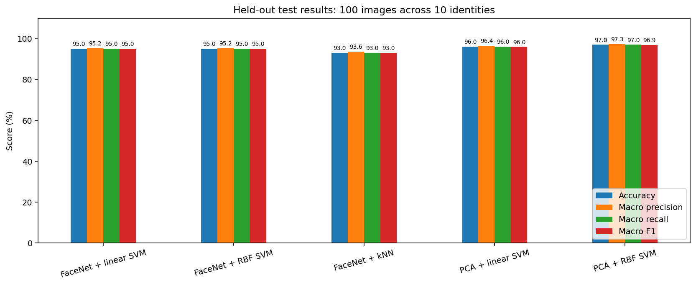
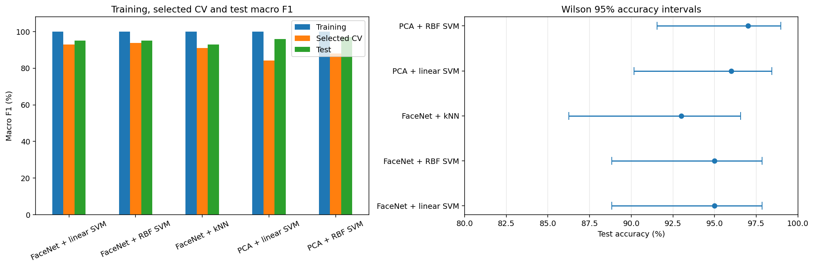
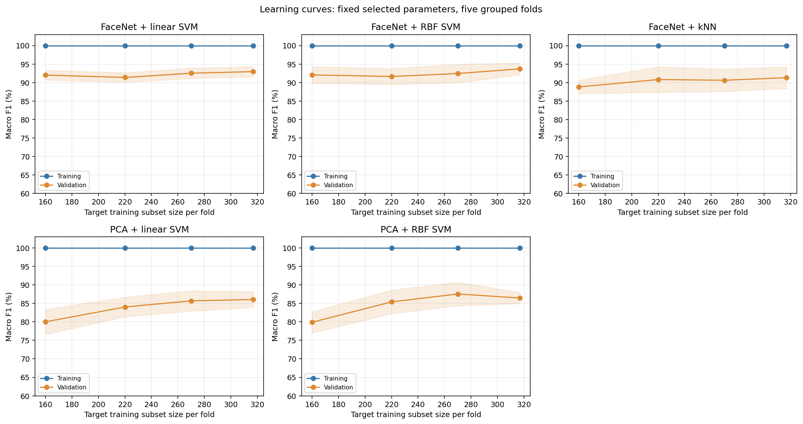

# Evaluation report

## Experiment

The sample contains 500 images from ten LFW identities. One source was manually excluded (`George_W_Bush_0039.jpg`), and one was rejected by the whole-image sharpness threshold (`John_Ashcroft_0043.jpg`, Laplacian variance below 20). The final split contains 398 training sources and 100 test sources, with ten test sources per identity.

MTCNN supplies bounding boxes and eye landmarks. Selection uses 60% within-image relative area, 35% centrality, and 5% detection confidence. The selection gallery supports manual inspection but does not certify every label. Both model families align the selected eyes directly from the original source and preserve split membership.

PCA inputs are 80 x 80 grayscale float32 pixels in [0, 1]. FaceNet inputs are 160 x 160 RGB PNGs in [0, 255]; DeepFace applies the Facenet normalization once in memory. FaceNet512 stays frozen and produces 512-dimensional embeddings, followed by L2 normalization and a classifier.

## Model selection and cross-validation

Hyperparameters were selected on training data using five-fold stratified group cross-validation and macro F1. Exact duplicate groups and flagged dHash candidates are kept together. The recorded candidate pair is in training, and its two sources stay in the same fold. PCA is part of a scikit-learn pipeline, so each fold learns its own PCA transformation from that fold's training portion.

The searches consider PCA components 50/100/150, whitening on/off, linear SVM C values, RBF C/gamma values, and FaceNet SVM/kNN settings. The saved metrics and settings record the winning parameters. This is **not nested cross-validation**: the CV score used for parameter selection can be optimistic. Learning curves use already-selected parameters, so they are descriptive rather than an unbiased second evaluation.

The best CV result within the FaceNet family is RBF SVM (93.71% macro F1). Within PCA it is RBF SVM (87.99%). The model choice should use training validation, not the largest observed test accuracy.

## Test results

| Model | Accuracy | Macro precision | Macro recall | Macro F1 | Correct / 100 |
| --- | ---: | ---: | ---: | ---: | ---: |
| FaceNet + linear SVM | 95% | 95.18% | 95% | 94.99% | 95 |
| FaceNet + RBF SVM | 95% | 95.18% | 95% | 94.99% | 95 |
| FaceNet + kNN | 93% | 93.59% | 93% | 93.02% | 93 |
| PCA + linear SVM | 96% | 96.42% | 96% | 95.98% | 96 |
| PCA + RBF SVM | 97% | 97.27% | 97% | 96.93% | 97 |

These are strong results for this small, closed-set experiment. Macro averaging gives each identity equal weight; balanced test support makes macro recall equal accuracy. FaceNet's linear and RBF SVMs produce identical test predictions. The notebook includes the ten-test-image breakdown for every identity, confusion matrices, and the eleven sources misclassified by at least one model.

## Overfitting and underfitting

Every model scores 100% when evaluated on its own training data. The train-to-CV macro F1 gaps are approximately 7.04 points for FaceNet linear SVM, 6.29 for FaceNet RBF SVM, 8.92 for kNN, 15.74 for PCA linear SVM, and 12.01 for PCA RBF SVM.

PCA's larger gaps suggest more variance and a greater overfitting risk, despite its high test accuracy. FaceNet generalizes more consistently across the training folds. For kNN, the training score is especially optimistic because a training sample can be its own nearest neighbor. That score alone cannot diagnose overfitting.

The models do not show obvious global underfitting: training fits are strong and validation scores are reasonably high. This does not rule out weaknesses for particular identities or capture conditions. Learning curves are included as additional evidence; their validation scores are not independent of the earlier parameter search.

## Leakage audit

The completed experiment checked matching train/test sources, labels and order across both families; unique source membership; current source pixel hashes; prepared PCA pixels; the FaceNet embedding cache signatures; and reconstructed cross-validation groups. No exact source or crop duplicate crossed the held-out split. One dHash candidate pair at distance <= 5 was found, entirely in training, and grouped during CV. The reference manifest and numeric results are included for inspection.

These checks address specific leakage paths; they do not prove complete independence. Perceptual hashes can miss related photographs. Quality decisions and the manual exclusion were made while exploring the dataset before the split. The test results have since been inspected repeatedly, so future tuning requires a fresh test set. Overlap between these celebrity images/identities and FaceNet's pretraining data has not been established or ruled out.

## Uncertainty and comparison

One test mistake changes accuracy by one percentage point. Wilson 95% intervals are roughly 88.8-97.8% for 95/100, 86.3-96.6% for 93/100, 90.2-98.4% for 96/100, and 91.5-99.0% for 97/100. They assume independent test observations and do not account for all possible relationships between photos.

Paired exact McNemar comparisons use each pair of models' disagreements on the same sources. None of the ten comparisons is significant at 5% after Holm correction; all adjusted p-values equal 1 in this run. This does not show that the models are equivalent. The sample is too small to resolve modest differences reliably.

## Next steps

Keep the current models as baselines. Inspect recurring errors and ambiguous face selections, gather more varied training examples, and obtain an independent test set before more tuning. Compare stronger regularization and smaller PCA representations inside training validation. For broader deployment, separately evaluate unknown identities, false matches, capture conditions, and larger identity sets. Consider FaceNet fine-tuning only after collecting enough diverse data and defining a validation protocol.

## Artifact notes

`results/` is a numeric snapshot from the completed local experiment. The executed results notebook regenerates its tables and English plots from this snapshot without downloading images or retraining. Fresh training outputs go to the generated dataset directories and do not automatically overwrite the published snapshot. Training time columns are classifier search times, not the complete preprocessing or embedding extraction cost. Dataset images, pretrained weights and fitted estimators are excluded from Git.
